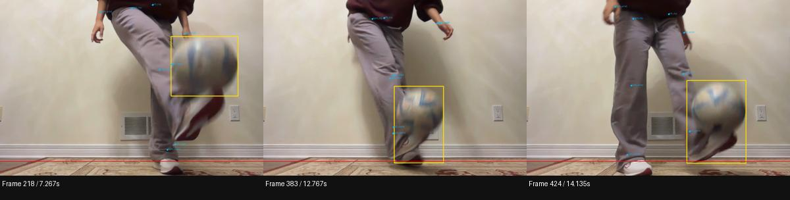

# Results on the supplied juggling clip

The end-to-end app runs locally and produces inspectable evidence, but **the automatic count underestimates this clip**. The selected baseline counts **15** touches. Independent visual review identifies **26 visible foot touches**, excluding the opening ground pickup. All 15 counted events match reference events within ±0.10 seconds; 11 reference touches are not automatically counted. Of those 11, 6 appear as flagged review candidates and 5 have no candidate.

These are development results on the same clip used to choose settings, not general accuracy estimates. The reference was prepared by the agent through visual inspection, not independently certified by the player. Contact timing is approximate within about 1–2 frames. You can import and correct `manual-review.json` in the app.

## Footage and reference procedure

- File: `Movie on 2026-10-16 at 2.02 AM.mov`, SHA-256 `73daba39d2ef14ea593cc59ac5bf8ce8f2a2db7547de6f91c05fc1ec39e2a7a3`.
- 1620 × 1080. Container metadata reports 432 frames and roughly 14.5 seconds; sequential decoding yields 427 frames, ending at presentation timestamp 14.201667 seconds. The silent playback copy lasts 14.235 seconds. No events are claimed for unavailable container frames.
- Before inspecting detector output, reviewed every third frame across the clip, then consecutive frames around each apparent contact. The initial notes are preserved in `manual-review-initial.json`.
- OpenCV random-seek frame numbers drifted from decoded frame numbers. Each selected reference image was matched exactly (zero difference in the compared resized images) to the sequentially decoded image, and its presentation timestamp was used in `manual-review.json`. The tail was then inspected using sequential decoding.
- The ball leaves the top of the image around 6.70–7.13 seconds. Hidden contacts in that interval cannot be verified. Reference events at 6.60 and 7.23 seconds are visible on either side. The decoded tail shows the final visible contact and continuation.
- No clear airborne floor bounce was identified in the reviewed footage. Floor-bounce rejection therefore has synthetic-test coverage only. Hands, thigh contacts, and knee contacts are not independently validated by this feet-only example.

## What improved

All runs used the same timestamp-based counter initially, with a 0.10-second velocity window. The final window is 0.14 seconds: this exposes 3 additional review candidates while keeping the same 15 counted events. No manual event times are embedded in the algorithm.

| Detector / input / detection threshold | Observed frames | Counted and matched | Unmatched counted | Runtime |
|---|---:|---:|---:|---:|
| YOLO11n / 960 / 0.15 | 234 | 3 | 0 | 48.2 s |
| YOLO11n / 1280 / 0.15 | 142 | 0 | 0 | 68.8 s |
| YOLO11s / 960 / 0.15 | 296 | 4 | 0 | 66.0 s |
| YOLO11n / 640 / 0.15 | 314 | 11 | 0 | 31.0 s |
| YOLO11s / 640 / 0.15 | 322 | 13 | 0 | 38.8 s |
| YOLO11n / 416 / 0.15 | 306 | 9 | 0 | 24.6 s |
| YOLO11s / 640 / 0.05 | 349 | 15 | 0 | 39.5 s |
| **Final browser upload, 0.14 s window** | **349** | **15** | **0** | **45.5 s** |

These are wall-clock observations on this Apple Silicon Mac, with model loading and playback encoding included, not controlled performance benchmarks. The final run is from a real browser upload. Larger input dimensions hurt this particular large, close-up ball. The lower detection threshold recovers some blurred observations; temporal association and contact rules still gate the count. The raw detector threshold is not a confidence in juggling accuracy.

## Event-level results and failure analysis

- **15 matched automatic events, 0 unmatched counted events, 11 missed reference events.** Matching is one-to-one within ±0.10 seconds. A matching total alone would not have been accepted.
- Six misses have review candidates: approximately **1.07, 1.53, 6.07, 7.27, 12.77, and 14.14 seconds**.
- Three candidates are flagged because observations are missing near contact. The 7.27-second candidate triggers a **false hand-proximity alarm**: the projected wrist is close to the ball even though the visible contact is a foot touch.
- At 12.77 and 14.14 seconds, the detected box includes parts of the blurred shoe. Its enlarged size makes the estimated ball bottom approach the approximate floor line. These are **foot contacts conservatively flagged as possible floor contact**, not evidence of actual bounces.
- Five visible contacts have no candidate: approximately **2.57, 4.07, 5.20, 6.60, and 10.50 seconds**. There is insufficient observed trajectory on one or both sides, or the contact sits inside an observation gap. The counter does not manufacture contacts from predicted points.
- Final tracking states: **349 observed, 60 briefly predicted, 18 lost frames**, across 33 missing-observation spans. The largest gap is approximately 6.57–7.17 seconds, covering the exit above the image. “Observed” means a detector association, not a manually verified correct box on every frame.
- The constant-velocity tracker can lag rapid acceleration; some dashed predictions are visibly displaced. They never provide the only evidence for a counted touch. The broad association gate and lack of a ball-specific appearance model remain limitations.
- Mean absolute timing difference among the 15 matched events is 0.0067 seconds, maximum about one frame. **This is not sub-frame timing accuracy:** the visual reference itself has 1–2-frame uncertainty.

See `event-comparison.csv` for every reference event, `final-evaluation.json` for one-to-one matches and misses, and `final-result.json` for all frame observations, landmarks, gaps, candidate reasons, and exact configuration.

Yellow boxes below show the ball detections; the red line is the approximate floor. The two right boxes include shoes, explaining the conservative floor flags.

## Verification and limits

- Python tests cover a genuine contact, a flight apex, duplicate/jitter candidates, synthetic floor bounce, initial pickup, prediction-only evidence, missing pose, short/long gaps, reacquisition jumps, irregular timestamps, video encoding/decoding timestamps, missing models, corrupt/empty/oversized uploads, concurrent-job rejection, asynchronous failure reporting, and one-to-one event matching.
- Frontend tests cover manual-review roundtrip, rejection of wrong-video/invalid annotations, preservation of automatic estimates, and timestamp frame lookup. TypeScript checking and production build pass.
- Browser checks used the actual supplied MOV: upload → progress → completed result → playable H.264 video → timestamp seek/frame step → manual reference import. Manual labels, retiming, adding, and deletion were exercised without changing the automatic count. HTTP byte-range seeking returned 206 with the requested bytes.
- The embedded browser did not signal completion of a file download. The export dialog therefore includes readable/copyable JSON alongside the normal download button. JSON content and import behavior are verified; native file-download completion in this embedded browser is not claimed.
- The narrow/mobile layout and desktop breakpoint were inspected. No external fonts, image assets, video APIs, or LLM services are used by the app.

The immediate useful next step is **player verification of the 26 reference events**, followed by testing additional clips with deliberate floor bounces, varied camera angles, and lighting. Improve detector boxes at blurred contacts before loosening count rules. New-footage evaluation is needed before claiming reliable counting, and live-camera speed has not been established.
