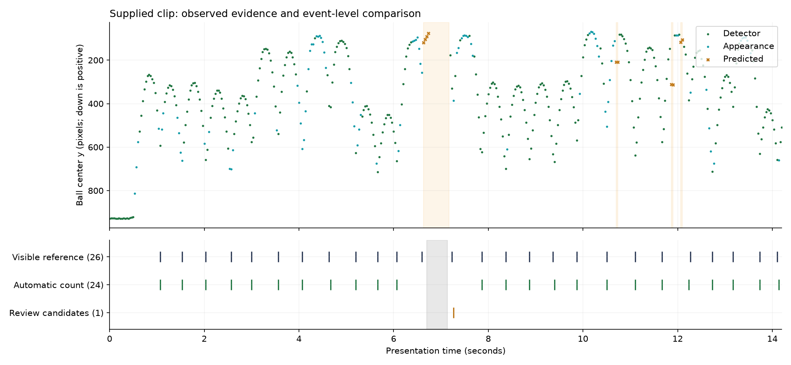

# Results on the supplied juggling clip

**Current update after testing three more clips:** the boundary safeguard reduces this original clip to **23 matched automatic touches out of 26**, with zero unmatched counted events and three misses. It removes a confirmed false count in a new clip but loses the real 10.50 s edge contact here. See [additional-clip results and tradeoff](additional-clips/README.md). The 24-count results and `final-*` files below are preserved as the **pre-safeguard baseline**; current original-clip output is `additional-clips/clip-0-edge-guard-result.json`.

## Previous appearance-matching baseline

The improved app counts **24 of the 26 reference touches**, up from 15. All 24 counted events match distinct reference events within ±0.10 seconds: **0 unmatched counted events and 2 misses**. One miss is a review candidate; the other has no candidate. The player independently confirmed the total of 26; individual reference timestamps remain approximate within 1–2 frames.

These are development results on the clip used to choose settings, not a general accuracy estimate. No target count or reference event timestamps are embedded in the analysis.

## What changed

YOLO11s at 640 pixels remains the detector. A short-lived grayscale template matcher now supplies image evidence between detector hits and repairs oversized boxes when texture and location agree. It does not depend on blue/white color segmentation. Detector anchors expire after 0.25 seconds; frame gaps longer than 0.15 seconds prevent bridging. Motion-only predictions still cannot establish contact. The counting rules, floor rules, and hand rule were not loosened.

| Measurement | Detector only | With appearance matching |
|---|---:|---:|
| Counted / matched | 15 / 15 | 24 / 24 |
| Extra counted events | 0 | 0 |
| Missed reference events | 11 | 2 |
| Review candidates | 6 | 1 |
| Observed frames | 349 | 404 |
| Predicted / lost frames | 60 / 18 | 10 / 13 |
| Missing-observation spans | 33 | 4 |
| Local API run including loading/encoding | 45.5 s | 43.4 s |

Runtimes are observations on this Apple Silicon Mac, not controlled speed benchmarks. The improved run contains 313 detector observations and 91 appearance observations. “Observed” identifies the evidence source, not a guarantee that every box is correct. The app distinguishes detector hits (green), appearance matches (teal), and predictions (dashed amber). No new dependency or model download is required.

Recovered contacts occur around **1.07, 1.53, 2.57, 4.07, 5.20, 6.07, 10.50, 12.73, and 14.14 seconds**. Consecutive frames around all nine were inspected: the boxes follow the ball, including two previously enlarged shoe-overlap boxes that caused floor warnings. See `recovered-contacts-0.jpg`, `recovered-contacts-1.jpg`, and `recovered-contacts-2.jpg`.

## Remaining failures

- **6.60 s:** contact immediately before the ball leaves the image. There is insufficient observed outgoing trajectory to propose a touch. The principal missing-observation interval is 6.63–7.17 s. We do not infer contacts across that gap.
- **Reference 7.23 s / candidate 7.27 s:** a visible foot touch remains flagged `possible_hand_contact` because a wrist landmark is projected close to the ball. This conservative classification error leaves it out of the automatic count. Manual review can correct it separately.
- The other three missing-observation spans are around 10.70–10.73, 11.87–11.90, and 12.07–12.10 seconds.
- Mean absolute timing difference for matched events is 0.0056 seconds; maximum is about one frame. This is **not** sub-frame measurement accuracy because reference timing has 1–2-frame uncertainty.
- Template matching can drift toward similar textures or fail under rotation, occlusion, and fast motion. Detector re-anchoring bounds the risk, but new footage is needed to evaluate it. Foot/knee/thigh generalization and real floor-bounce rejection remain unverified.

The automatic count stays 24; the separately editable reference remains 26. See `event-comparison.csv`, `final-evaluation.json`, and `final-result.json` for event matches, misses, observation sources, and exact settings. The earlier detector comparison and baseline failure analysis are preserved in [DETECTOR_ONLY_RESULTS.md](DETECTOR_ONLY_RESULTS.md) and `detector-only-*` files. Reproduce that baseline with `--no-appearance`.

## Footage and reference procedure

- File: `Movie on 2026-10-16 at 2.02 AM.mov`, SHA-256 `73daba39d2ef14ea593cc59ac5bf8ce8f2a2db7547de6f91c05fc1ec39e2a7a3`.
- 1620 × 1080. Container metadata reports 432 frames and roughly 14.5 seconds; sequential decoding yields 427 frames, ending at presentation timestamp 14.201667 seconds. The silent playback copy lasts 14.235 seconds. No events are claimed for unavailable container frames.
- Before inspecting detector output, reviewed every third frame across the clip, then consecutive frames around each apparent contact. The initial notes are preserved in `manual-review-initial.json`.
- OpenCV random-seek frame numbers drifted from decoded frame numbers. Each selected reference image was matched exactly (zero difference in the compared resized images) to the sequentially decoded image, and its presentation timestamp was used in `manual-review.json`. The tail was then inspected using sequential decoding.
- The ball leaves the top of the image around 6.70–7.13 seconds. Hidden contacts in that interval cannot be verified. Reference events at 6.60 and 7.23 seconds are visible on either side. The decoded tail shows the final visible contact and continuation.
- No clear airborne floor bounce was identified in the reviewed footage. Floor-bounce rejection therefore has synthetic-test coverage only. Hands, thigh contacts, and knee contacts are not independently validated by this feet-only example.

## Verification and limits

**Current checks:** 28 Python tests and 4 frontend tests pass; TypeScript checking and production build pass. New synthetic tests cover textured-object motion/blur, blank and different-texture rejection, detector-anchor expiry, long frame gaps, preserving ordinary detector boxes, repairing inflated boxes, and missing anchors. These tests are not real-world accuracy measurements. The final supplied MOV was submitted through the local HTTP upload endpoint and its completed result inspected in the browser: 24 estimates, the existing 26-event review retained, appearance status during frame stepping, and playable video.

- Python tests cover a genuine contact, a flight apex, duplicate/jitter candidates, synthetic floor bounce, initial pickup, prediction-only evidence, missing pose, short/long gaps, reacquisition jumps, irregular timestamps, video encoding/decoding timestamps, missing models, corrupt/empty/oversized uploads, concurrent-job rejection, asynchronous failure reporting, and one-to-one event matching.
- Frontend tests cover manual-review roundtrip, rejection of wrong-video/invalid annotations, preservation of automatic estimates, and timestamp frame lookup. TypeScript checking and production build pass.
- Browser checks used the actual supplied MOV: upload → progress → completed result → playable H.264 video → timestamp seek/frame step → manual reference import. Manual labels, retiming, adding, and deletion were exercised without changing the automatic count. HTTP byte-range seeking returned 206 with the requested bytes.
- The embedded browser did not signal completion of a file download. The export dialog therefore includes readable/copyable JSON alongside the normal download button. JSON content and import behavior are verified; native file-download completion in this embedded browser is not claimed.
- The narrow/mobile layout and desktop breakpoint were inspected. No external fonts, image assets, video APIs, or LLM services are used by the app.

Next useful validation is a different clip with known event times, including deliberate floor bounces. Keep the current clip as a regression case, and improve the wrist/foot ambiguity only with evidence that also preserves genuine hand-contact rejection.
